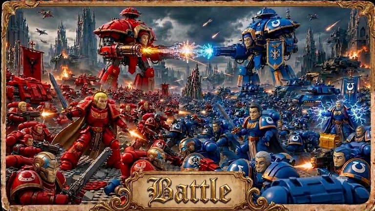
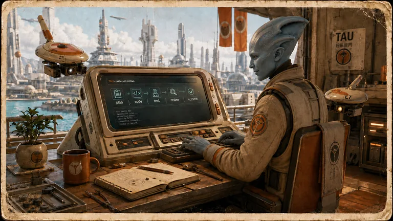
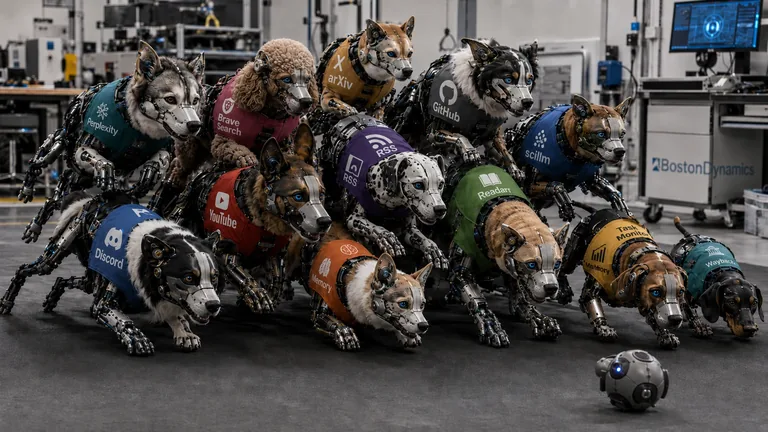
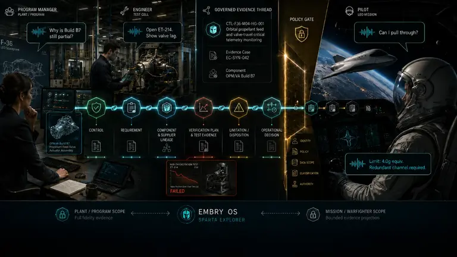
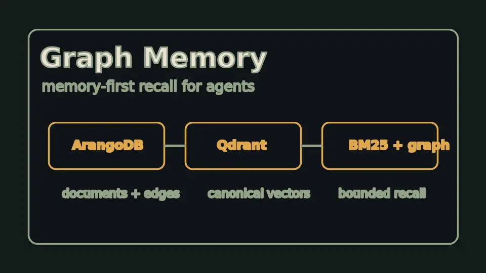

# Agent Skills


**Bring me the problem before it has a specification.**

I'm Graham Anderson. This is the working laboratory behind my agent engineering
practice: reusable tools, research experiments, bounded workers, and the lessons
I would rather not learn twice.

You bring the situation, the constraints, and room to investigate. I work out
what actually needs solving, test the uncertain parts, and build. Defining the
problem is part of the work—not homework you need to finish before we talk.

[Explore the work](https://grahama.co) ·
[Start here](#five-places-to-start) ·
[Browse the skills](skills/) ·
[About me](https://grahama.co/resume) ·
[Get in touch](#bring-me-the-project-you-shelved)

> **Public source, partly private runtime.** This is a working research toolbox,
> not a turnkey SDK. Some paths need configured memory services, model providers,
> browser bindings, credentials, or media storage. You can inspect the public
> code and contracts without having my runtime; you cannot assume every workflow
> will run in a fresh clone.

| If your problem involves… | Start with |
|---|---|
| Reliable agent workflows | [Tau](https://github.com/grahama1970/tau) |
| Proving whether automation works | [agentic-evals](skills/agentic-evals/README.md) |
| Adversarial validation | [Battle](skills/battle/README.md) |
| Organizational memory and provenance | [Memory](https://github.com/grahama1970/memory-public) |
| Voice, personas, or multimodal systems | [Persona Dream](skills/persona-dream/README.md) |
| Something unclear or cross-cutting | [Contact Graham](#bring-me-the-project-you-shelved) |

Typical engagements start with one of four shapes:

- investigate an underspecified technical problem;
- prototype and test the risky part;
- repair or harden an existing agent workflow; or
- build an evidence-backed implementation and handoff.

## Five places to start

Pick the question that interests you. These are routes into the work, not a
ranking of finished products.

### How do you let agents act without accepting their word for what happened?

**[Tau](https://github.com/grahama1970/tau)** explores that problem through
bounded execution, typed handoffs, evidence checks, and explicit stop conditions.
The interesting part is not drawing a graph of agents. It is deciding what must
be true before the next action is allowed.

Start with the canonical repository and its current-status link. The
[local Tau skill](skills/tau/README.md) is the agent-facing integration, not a
second implementation of the whole system. Useful when an internal agent must
act without bypassing review or losing a trace of what happened.

### What does a passing evaluation actually establish?

**[agentic-evals](skills/agentic-evals/README.md)** connects evaluation results to
specific capability claims. Inspect the
[runner](skills/agentic-evals/src/runner.py),
negative controls, and
incident regressions.

The question is whether a check can catch the failure that matters—not how many
checks print green. Mechanism checks, real-path execution, and independent
read-back have different evidentiary roles. Useful when a team has green checks
but cannot say what they establish.

### Can a proposed repair survive an adversarial check?

**[Battle](skills/battle/README.md)** investigates this through authorized,
isolated Red/Blue work, independent judging, and retained campaign evidence.
Generated proposals do not get to declare their own success.

Its guide separates the backend, replay interface, current evidence, and missing
coverage. Follow those distinctions rather than treating one successful campaign
as proof of the entire system. Useful before trusting generated repairs or
security recommendations.

### Why should an agent rediscover yesterday's work?

**[Memory](https://github.com/grahama1970/memory-public)** starts with recall:
what is already known, where it came from, and whether it applies here.
**[ingest-code](skills/ingest-code/SKILL.md)** supplies structured code information
so remembering can include source files, symbols, and relationships—not just
conversation summaries.

The Memory repository is a **public architecture overview**; the underlying
operator and memory records are private. The
[Memory skill contract](skills/memory/SKILL.md) and ingest-code implementation
are inspectable here. Useful when agents or teams need to recover prior decisions
with provenance instead of rediscovering them.

### Could a synthetic dream help a voice persona more than remembering alone?

**[Persona Dream](skills/persona-dream/README.md)** is a multimodal research
project about memory, synthetic experience, voice, and continuity. The dream is
something to inspect and test, not something to quietly promote into history.

A rendered dream is an output, not proof that dreaming helps. A negative result
is a useful result. The creative work is not decoration around the engineering;
it asks different engineering questions. Useful for multimodal, persona, and
voice systems where continuity and emotional delivery must be inspected.

## How I work

I want ownership of the investigation, not just a list of implementation tasks.
That may mean challenging the original request, finding a smaller problem worth
solving first, or running an experiment before choosing an architecture. You do
not need to know which model or framework to ask for.

I use agents heavily. I remain responsible for the technical decisions, the
trade-offs, and the result. Inside the workshop, I turn findings into bounded
work for agents, separate implementation from verification, and keep evidence
of what changed. A receipt is a record of a particular run and its artifacts—not
a certificate that everything is correct.

More agents are not automatically the answer. I prefer an existing tool, a
small deterministic program, or a cheaper model when it does the job. Another
skill or orchestration layer has to earn its place.

I work best with curious people who can provide access, make consequential
decisions, and leave room to investigate. Clear budgets, data boundaries, and
acceptance criteria help. The work moves fastest when reversible experiments can
proceed within those agreed boundaries. Expect me to explain what I tried, what
the evidence changed, and when an approach is not worth pursuing.

## Reading the evidence

This repository contains experiments, exercised capabilities, and unfinished
integrations. They do not all have the same maturity or setup requirements.
Read the selected project's current status and limitations before treating it
as a dependency.

A contract describes intended behavior. Source shows an implementation. A test
or run record supports only the behavior it actually exercised. Check the
source revision, inputs, assertions, and date. The presence of `sanity.sh` is
not a passing test, a passing test is not complete coverage, and a historical
receipt is not evidence that today's checkout still behaves the same way.

Screenshots show a captured interface. Generated artwork shows an output or
illustrates an idea. Neither establishes reliability by itself. A public
overview of a private system is not access to that system's implementation or
operational evidence. Missing evidence stays missing; this README supplies no
repository-wide readiness verdict.

<details>
<summary>Reviewing the work with your own agent?</summary>

Use the public source. A useful review request is:

```text
Choose one system relevant to my problem. Record the revision you inspect.
Trace its stated purpose through the implementation, tests, and available
run evidence. Inspect a failure or refusal path as well as a success path.
Cite exact files and distinguish code you read from commands you executed.
Report private dependencies, stale evidence, and untested claims explicitly.
Do not infer quality from skill counts, commit volume, or the author's prose.
Do not launch services or perform external actions without authorization.
```

</details>

## Explore the workshop

A **[skill](skills/)** is a reusable capability. An **agent** is a
bounded worker role. **Persona contracts**
describe identities and behavior; **hooks** attach checks to lifecycle events. The **[site](site/)** is
the source for grahama.co, and **[my résumé](https://grahama.co/resume)** carries the career
history rather than repeating it here.

The five starting points are not the whole practice. Browser control,
document extraction, research, video, debugging, model execution, and
evidence work connect to them in different ways. Follow a useful thread; you
do not need to understand the entire repository before borrowing something.

## Fun Stuff I'm Working On

These images are project artwork, not runtime evidence. Open a project's guide
for its implementation, dependencies, current status, and proof boundaries.
Memory and Sparta Explorer link to public overviews of private systems.

<table>
  <tr>
    <td align="center">
      <a href="https://github.com/grahama1970/agent-stack-public/blob/main/skills/persona-dream/README.md">
        
      </a>
      <br/><strong>Persona Dream</strong><br/><em>Memory, dreams, and voice research</em>
    </td>
    <td align="center">
      <a href="https://github.com/grahama1970/agent-stack-public/blob/main/skills/surf/README.md">
        
      </a>
      <br/><strong>Surf</strong><br/><em>Browser control and tab provenance</em>
    </td>
    <td align="center">
      <a href="https://github.com/grahama1970/agent-stack-public/blob/main/skills/battle/README.md">
        
      </a>
      <br/><strong>Battle</strong><br/><em>Adversarial testing and independent judging</em>
    </td>
  </tr>
  <tr>
    <td align="center">
      <a href="https://github.com/grahama1970/tau">
        
      </a>
      <br/><strong>T'au</strong><br/><em>Bounded agent execution and evidence</em>
    </td>
    <td align="center">
      <a href="https://github.com/grahama1970/extractor">
        
      </a>
      <br/><strong>Extractor</strong><br/><em>Documents into inspectable structure</em>
    </td>
    <td align="center">
      <a href="https://github.com/grahama1970/agent-stack-public/blob/main/skills/dogpile/README.md">
        
      </a>
      <br/><strong>Dogpile</strong><br/><em>Multi-source research with citations</em>
    </td>
  </tr>
  <tr>
    <td align="center">
      <a href="https://github.com/grahama1970/agent-stack-public/blob/main/skills/watch/README.md">
        
      </a>
      <br/><strong>Watch</strong><br/><em>Video, frames, and transcript evidence</em>
    </td>
    <td align="center">
      <a href="https://github.com/grahama1970/agent-stack-public/blob/main/skills/scillm/README.md">
        
      </a>
      <br/><strong>Scillm</strong><br/><em>Shared model-execution tooling</em>
    </td>
    <td align="center">
      <a href="https://github.com/grahama1970/agent-stack-public/blob/main/skills/debugger/README.md">
        
      </a>
      <br/><strong>Debugger</strong><br/><em>Breakpoints and runtime inspection</em>
    </td>
  </tr>
  <tr>
    <td align="center">
      <a href="https://github.com/grahama1970/sparta-public">
        
      </a>
      <br/><strong>Sparta Explorer</strong><br/><em>Public overview: evidence and human decisions</em>
    </td>
    <td align="center" colspan="2">
      <a href="https://github.com/grahama1970/memory-public">
        
      </a>
      <br/><strong>Memory</strong><br/><em>Public overview: recall with provenance</em>
    </td>
  </tr>
</table>

<details>
<summary>Recorded inventory</summary>

## At a Glance

**Historical inventory snapshot: 2026-08-26, source `b2a2b9235d`.**
These are recorded inventory counts, not today's totals or a readiness score.

| Inventory | Count |
|---|---:|
| Skills | 364 |
| With `sanity.sh` | 303 |
| Agent directories | 92 |

For the latest committed snapshot, inspect
`site/inventory.json` and
`site/build-manifest.json`, including their source
stamp and date. A recent README edit does not make an inventory fresh.
`With sanity.sh` counts script presence, not successful execution or coverage.

</details>

## Using and contributing

Start with one capability, not the entire runtime.

```bash
git clone --depth 1 https://github.com/grahama1970/agent-stack-public.git
cd agent-stack-public

# Browse the contracts without starting services or calling a provider.
find skills -maxdepth 2 -name SKILL.md | sort
```

Read the selected README, then its full `SKILL.md` before running anything.
**The README explains; the skill contract governs operation.** Worker roles
have their own `AGENTS.md` contracts. Follow the selected capability's setup
instructions, dependencies, data boundaries, and proof commands; there is no
single command that qualifies the whole repository.

Useful contributions include a reproducible bug, a tighter test, clearer
instructions, or a missing integration. Reuse existing capabilities before
adding another framework. Keep changes focused and preserve unrelated work.
When private infrastructure prevents a check, state what you could run and
what remains untested rather than substituting a success claim.

For work-item and maintenance details, use the existing contracts:
**[ticket](skills/ticket/SKILL.md)** for scoped work and proof,
**[project-watchdog](skills/project-watchdog/SKILL.md)** for scheduled repair,
and **[monitor-website](skills/monitor-website/SKILL.md)** for public-site
synchronization. They belong in the execution process, not in a client's
homework.

Public examples and issues must not include credentials, private browser or
inbox context, client data, regulated material, or identifying runtime details.
Use minimal sanitized reproductions. Report a suspected sensitive disclosure
privately rather than copying it into another public issue.

## Bring me the project you shelved

Tell me what you are trying to achieve, what has resisted the obvious approach,
and which constraints are real. A finished specification is not required.

The person you talk to is the person who investigates, architects, builds,
and answers for the work.

**[graham@grahama.co](mailto:graham@grahama.co)** ·
[grahama.co](https://grahama.co) · [Background and experience](https://grahama.co/resume)
